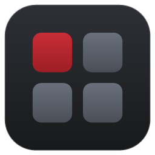

<p align="center">
  
</p>

# DonkiePane

<p align="center"><a href="README.md">English</a> · <b>Nederlands</b></p>

Vakken (panes) op je Windows-bureaublad voor je snelkoppelingen en je taken. Met een rustig uiterlijk en een knipoog naar de ruitjes van een theedoek.

## Wat het doet

- **Panes op het bureaublad.** Ze staan achter je vensters en blijven staan bij Win+D.
- **Je bureaubladiconen in panes.** Wat je op het bureaublad met een bestand of snelkoppeling doet, kan in een pane ook: openen, selecteren (Ctrl, Shift, een kader trekken), slepen naar Verkenner, een app, een map of de Prullenbak, bestanden in een pane slepen, Delete, F2, Ctrl+C/X/V, Ctrl+Shift+N, Alt+Enter en het menu van Verkenner (rechts klikken op een lege plek geeft Plakken en Nieuw). Laat je iconen los op een lege plek van het bureaublad, dan komt daar een nieuw pane mee. Windows voert het uit, dus meldingen en Prullenbak zijn zoals altijd; uit zichzelf verplaatst of verwijdert DonkiePane niets. Nieuwe bestanden komen in de Inbox-pane, of in het pane waarin je ze plakte of neerzette.
- **Weergave en sortering per pane.** Grote iconen, kleine iconen of een lijst, in je eigen volgorde of gesorteerd op naam, type of datum (rechtsklik op de titelbalk). Maak de iconen groter of kleiner met Ctrl+scrollwiel, en verberg desgewenst de namen onder de iconen (de naam verschijnt dan bij aanwijzen). Begin te typen in een pane om de iconen op naam te filteren; Esc haalt het filter weg.
- **Iconen die je niet meer gebruikt worden grijs.** Bureaubladiconen die je een maand, drie maanden of een halfjaar niet via een pane hebt geopend of gewijzigd, worden grijs (Instellingen → Panes; staat standaard uit).
- **Takenpanes.** Taken toevoegen, afvinken, ordenen en met een ster markeren. Lokaal, of gesynchroniseerd met een bron die je zelf toevoegt:
  - Google Taken
  - Home Assistant (to-do lijsten)
  - een eigen dienst via het protocol Tasks REST v1

  Wat je offline doet wordt bewaard en later verstuurd. Zie [docs/Bronnen.md](docs/Bronnen.md). Bij taken met een deadline van vandaag krijg je een melding bij de klok (hooguit één per taak per dag; uit te zetten in Instellingen).
- **Mappanes.** Een pane dat de inhoud van een map naar keuze toont (Nieuw mappane in het menu bij de klok). Dubbelklik op een map om erin te kijken, Backspace gaat terug; typen zoekt in die map en de mappen eronder.
- **Tabbladen.** Sleep een pane aan zijn titelbalk op de titelbalk van een ander pane en houd even vast: het wordt een tabblad. Trek een tabblad uit de titelbalk om het weer los te maken. Bestanden die je boven een tabblad houdt, openen dat tabblad.
- **Regels.** Nieuwe bestanden op het bureaublad gaan meteen naar het juiste pane, op extensie, naam of omdat het een map is (Instellingen → Regels). Wat al in de Inbox staat, kun je daar in één keer laten indelen.
- **Opgerolde panes even openen.** Een opgerold pane gaat open bij aanwijzen of met één klik en rolt weer op als de muis weggaat (Instellingen → Panes).
- **Panes naar voren halen.** Met een sneltoets (standaard Ctrl+Alt+Spatie, in te stellen) komen alle panes boven je vensters; nog een keer, Esc of ernaast klikken zet ze terug.
- **Rustig en aanpasbaar.** Effen thema's, licht of donker (of zoals Windows), matglas (je bureaubladachtergrond vervaagd achter het pane), een eigen kleur en transparantie per pane, ronde of rechte hoeken, een ruitraster om panes op vast te klikken en optioneel het theedoek-ruitpatroon.
- **Dubbelklik op een leeg stuk bureaublad** verbergt alle panes; nog een keer haalt ze terug.
- **Nederlands en Engels.** DonkiePane volgt de taal van Windows; kiezen kan in Instellingen → Taal. Vertalingen staan in `src/DonkiePane.Core/Localization`.
- **Indeling exporteren en importeren.** Instellingen → Gegevens bewaart je panes en hun plek als bestand, als reservekopie of om ze op een andere pc over te zetten. Taken, bronnen en tokens gaan niet mee.
- **Meerdere schermen.** Valt een scherm weg, dan komen de panes naar een ander scherm en gaan ze terug zodra het scherm terugkomt.

## Installeren

Download `DonkiePane-Setup-<versie>.exe` bij de [releases](https://github.com/tribalgfx/DonkiePane/releases) en start hem. Er is geen .NET en geen beheerder nodig; het programma komt in `%LOCALAPPDATA%\Programs\DonkiePane`. Windows kan een SmartScreen-waarschuwing tonen omdat de installer niet is ondertekend: kies **Meer info** en dan **Toch uitvoeren**.

Bij de eerste start legt een welkomstscherm uit wat er met je bureaublad gebeurt en kun je kiezen of de Windows-iconen verborgen worden. DonkiePane meldt zelf als er een nieuwe versie is en werkt op jouw klik bij (of draai een nieuwe installer eroverheen); verwijderen gaat via Apps en functies. Zie [docs/Installeren.md](docs/Installeren.md).

## Zelf bouwen

Nodig: Windows 10 of 11. De scripts controleren zelf of de .NET SDK (zie `global.json`) en, voor de installer, Inno Setup aanwezig zijn en installeren wat ontbreekt met winget. Windows kan daarbij om toestemming vragen.

```powershell
.\scripts\install.ps1            # bouwt en installeert naar %LOCALAPPDATA%\Programs\DonkiePane
.\scripts\build-installer.ps1    # maakt artifacts\DonkiePane-Setup-<versie>.exe
dotnet test                      # de tests (de .NET SDK moet dan al aanwezig zijn)
```

Wie alleen DonkiePane gebruikt, heeft dit niet nodig: de installer bevat alles, ook .NET.

## Opbouw

| Map | Inhoud |
|---|---|
| `src/DonkiePane.App` | WPF: panes, tray-icoon, instellingen, thema's |
| `src/DonkiePane.Core` | Model en logica: panes, items, raster, opslag, vertalingen |
| `src/DonkiePane.Shell` | Win32 en de Windows-shell: bureaubladlaag, iconen, slepen en neerzetten, menu's |
| `src/DonkiePane.Tasks` | Contract voor takenbronnen, plug-in-lader, lokale opslag, offline wachtrij |
| `src/DonkiePane.Plugins.*` | De bronnen zelf: Google Taken, REST, Home Assistant |
| `installer`, `scripts` | Installer en hulpscripts |
| `tests` | Tests voor Core, Tasks en App |

Het ontwerp en de keuzes staan in [PLAN.md](PLAN.md).

## Gegevens en veiligheid

- Instellingen, panes en taken staan per gebruiker in `%APPDATA%\DonkiePane`. Geheimen (tokens, wachtwoorden van bronnen) staan daar versleuteld met Windows (DPAPI) en nooit in een gewoon bestand of in git.
- Verbindingen met bronnen gaan alleen over HTTPS (Home Assistant over http alleen na een uitdrukkelijke keuze). Een bron kan met een certificaat-vingerafdruk worden vastgepind.
- Plug-ins worden alleen geladen uit de map `plugins` naast het programma en uit `%APPDATA%\DonkiePane\plugins`, nooit van internet.
- De update-controle vraagt alleen de nieuwste release op bij GitHub, zonder gegevens over jou. Een nieuwe versie wordt pas gedownload als je op Nu bijwerken klikt, en alleen geïnstalleerd als het SHA-256-controlegetal van GitHub klopt.
- Crasht DonkiePane, dan komt de foutmelding in `%APPDATA%\DonkiePane\crash.log`. Dat bestand blijft op je pc; er wordt niets verstuurd.
- Gaat er iets mis en blijven je Windows-iconen verborgen? Rechtsklik op het bureaublad → **Beeld** → **Bureaubladpictogrammen weergeven**.

## Licentie

Copyright (C) 2026 tribalgfx

DonkiePane is vrije software onder de [GNU General Public License](LICENSE), versie 3 of (naar keuze) een latere
versie. Kort gezegd: je mag het gebruiken, aanpassen en delen, ook commercieel, zolang wat je verspreidt open blijft
onder dezelfde licentie, met de broncode erbij. DonkiePane komt zonder enige garantie. De licentietekst zelf is
Engels; alleen die geldt.
